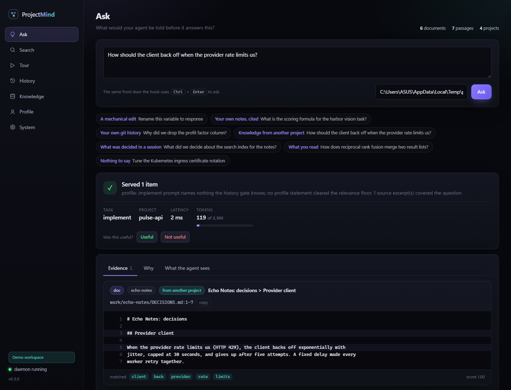
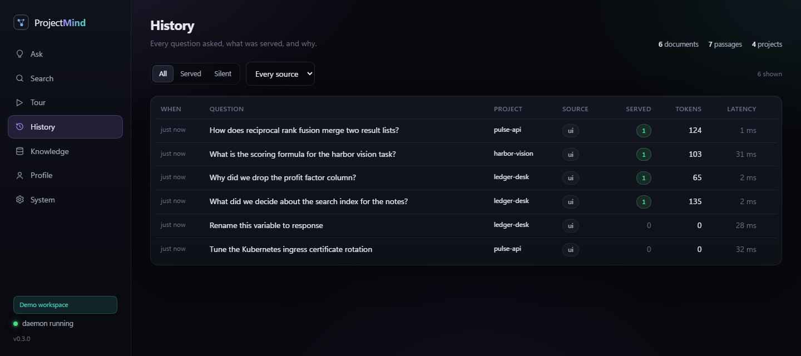
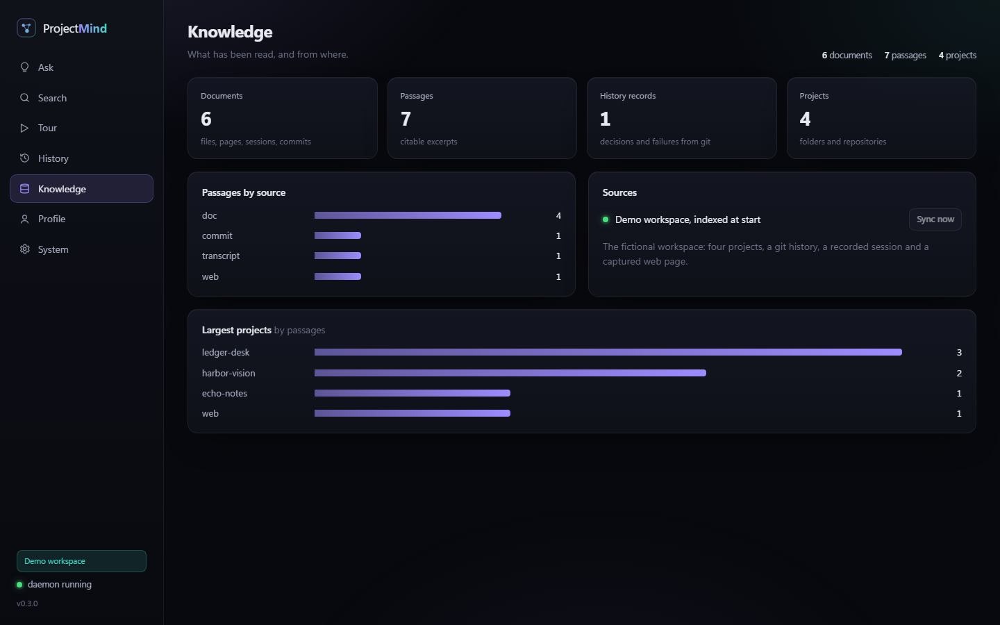

# ProjectMind

**A local memory for your coding agent. It answers from your own work — notes, commits,
competition logs, notebooks, documents, past agent sessions and the docs you read — with
verbatim excerpts and exact citations, and stays silent when it has nothing.**

[](https://github.com/ParthBiyani/ProjectMind/actions/workflows/ci.yml)
[](https://github.com/ParthBiyani/ProjectMind/releases)


[](LICENSE)



## Why

- **Agents forget across projects.** Per-repository context can't see the bug you fixed
  elsewhere, the note that explains a metric, or the commit that dropped a column.
- **Guessing is worse than forgetting.** An unrelated passage in the context silently
  makes the agent worse. ProjectMind serves a passage only when it covers the question.
- **Verbatim and cited.** Every item is copied from a source with its place
  (`notes.md:12-19`, a commit URL, `paper.pdf (page 3)`, `session.jsonl (turn 19)`).
- **Private by construction.** Everything stays on your machine. No API key needed.

## Results

Measured on a real knowledge base (~9,000 documents, 27,403 passages) with 42 questions,
including 12 deliberately reworded and 10 about topics that appear nowhere:

| | Lexical | + semantic search |
|---|---|---|
| Right source cited (answerable questions) | **0.812** | **0.844** |
| Silent on absent topics | **1.000** | **1.000** |
| Explicit search finds the right source | 28 / 32 | **30 / 32** |
| Hook latency (through the daemon) | ~150 ms | ~150 ms |

Synthetic, reproducible 40-query set (pinned clock): gate precision **1.000**, precision@5
**0.750**, cross-project hit rate **0.325**, false injection **0.174** against a 0.10 target
(missed, and documented). Caveats and method: [docs/evaluation.md](docs/evaluation.md).

## Features

- **Knowledge base** over git history, notes and `CLAUDE.md` logs, script docstrings,
  notebooks, training-log result lines, small result files, PDF / Word / PowerPoint,
  Claude Code sessions, and browser history and pages (minus a never-capture list).
- **Grounded retrieval**: rarity-weighted coverage with an absolute floor, anchor terms,
  named-project preference, near-duplicate suppression, a hard 2,300-token budget.
- **Optional semantic search** with a calibrated bar for automatic injection and a
  labelled, generous explicit search ([docs/semantic.md](docs/semantic.md)).
- **Claude Code integration**: a pre-prompt hook (thin client, ~150 ms) and an MCP server.
- **Always growing**: a local daemon syncs every 30 minutes at low priority and starts at logon.
- **Web UI** with a **demo mode** that never shows personal data ([docs/web-ui.md](docs/web-ui.md)).
- **Full interaction history**: every prompt, what was served, and why each candidate was
  kept or cut; replay, label and export to evaluation.
- **Privacy guards**: whitelist walker, data-dump and identity-document guards, credential
  and identifier dropping, read-only sources, re-auditable index.
- **SQLite by default, Postgres + pgvector** behind the same storage protocol.

## Quickstart (Windows, Python 3.11+)

```powershell
git clone https://github.com/ParthBiyani/ProjectMind.git
cd ProjectMind
py -m venv .venv
.venv\Scripts\python -m pip install -e ".[mcp,docs]"     # add ,semantic for meaning search
.venv\Scripts\Activate.ps1

projectmind ui --demo                       # see it first: a fictional workspace in the browser
projectmind init                            # create the store, load starter profile proposals
projectmind sources add "D:/Projects"       # choose what to read (look inside first)
projectmind sources add "~/.claude/projects" --kind transcripts --depth 0
projectmind sync                            # read it (minutes the first time)
projectmind install claude-code            # hook + MCP server, with backups; restart Claude Code
projectmind schedule install                # start the daemon at logon
projectmind ui                              # the dashboard on your own memory
projectmind doctor                          # verifies everything, including a live hook run
```

Ask from the terminal:

```powershell
projectmind context "Why did we drop the profit factor column?" --project D:\Projects\MyApp
projectmind sources search "how did I handle rate limits"
projectmind history list
```

## How it works

```
 folders / git / sessions / browser ──► walker ─► chunker ─► secret scan ─► index
                                                                              │
 Claude Code hook ──localhost──► daemon ──► get_context                       │
                                              1 skip mechanical edits         │
                                              2 profile slice                 │
                                              3 history records (gated)  ◄────┤
                                              4 cited passages (coverage) ◄───┘
                                              5 optional meaning matches
                                              6 budget ─► excerpts + citations
```

The full story — the problem, why v0.1 failed on a real machine, every decision and the data
behind it — is in **[docs/how-it-works.md](docs/how-it-works.md)**. Modules and design rules:
[docs/architecture.md](docs/architecture.md).

## Web UI

`projectmind ui` opens the dashboard served by the daemon at `http://127.0.0.1:<port>/ui/`.
Plain HTML/CSS/JS, dark theme, no external requests.

| View | |
|---|---|
| Ask | The answer with cited excerpts, tokens, latency, the "why" trace and feedback |
| Search | By words and by meaning, each result labelled |
| History · Knowledge · Profile | Every interaction; what is indexed and Sync now; approve or reject statements |
| Evaluation · System | Real-data report (and the scripted tour in demo mode); daemon and settings |

`projectmind ui --demo` serves a fictional, fully indexed workspace on a free port, for demos.

| History | Knowledge |
|---|---|
|  |  |

## Browser extension

A Manifest V3 extension for **Edge and Chrome** captures the readable text of the pages you
read, except sites on a never-capture list you edit in its options (banking, brokers, mail,
social, sign-in pages and more are on it from the start). It never reads this machine or
private windows, and skips pages that ask for a password. Install steps:
[extension/README.md](extension/README.md).

## Privacy

Local only; no network call on the retrieval path. The daemon and web UI listen on loopback
with a bearer token and a Host check. Credentials and personal identifiers are dropped, not
redacted; identity documents are never opened; browser reading is opt-in, with a never-capture list.
Details, each backed by a test: [docs/privacy.md](docs/privacy.md).

## Configuration

Read from the environment and `~/.projectmind/.env` (never a project's `.env`).

| Variable | Default | |
|---|---|---|
| `PROJECTMIND_HOME` | `~/.projectmind` | database, sources, logs, token |
| `PROJECTMIND_DB_URL` | unset | a `postgresql://` URL switches to Postgres + pgvector |
| `PROJECTMIND_AUTHORS` | git `user.email` | whose commits are yours |
| `PROJECTMIND_HISTORY` | `full` | `full`, `minimal` or `off` |
| `PROJECTMIND_SEMANTIC` | `false` | meaning search (`projectmind semantic enable`) |
| `PROJECTMIND_EVIDENCE_COVERAGE_FLOOR` | `0.6` | how much of a question a passage must cover |
| `PROJECTMIND_DAEMON_PORT` | `47615` | fixed so the extension can find it |

All settings with rationale: [`config.py`](src/projectmind/config.py).

## Commands

| | |
|---|---|
| `ui [--demo]`, `demo` | Dashboard; guided tour on a fictional workspace |
| `sources add / list / scan / search / audit`, `sync` | What is read; one incremental pass |
| `install claude-code`, `serve`, `daemon status / stop / token`, `schedule install` | Integration and the always-on daemon |
| `context`, `history list / show / replay / label / export` | What the agent would receive; everything asked |
| `profile review / add / edit`, `semantic status / enable / index`, `browser enable / scan` | Profile, meaning search, browser |
| `eval run / real`, `doctor` | Measure it; verify the install |

MCP tools: `get_context`, `search_sources`, `search_memory`, `memory_feedback`, `memory_stats`
([docs/integration.md](docs/integration.md)).

## Project layout

```
src/projectmind/
  service.py      the front door (get_context, search, history)
  retrieval/      cited-passage and history-record retrieval
  semantic.py     optional meaning search
  gate/           prompt analysis, gating, token budget
  sources/        walker, chunker, readers, transcripts, browser, privacy audit
  ingestion/      git and GitHub extractors
  storage/        Store protocol, SQLite and Postgres backends, migrations
  daemon.py       local server: hook answers, scheduler, capture, web UI
  web/            dashboard and its JSON API
  hook_entry.py   standard-library hook client
  mcp/  cli/  evaluation/  profile/  reflection/
extension/        Edge / Chrome extension
eval/             synthetic evaluation set and baselines
```

## Development

```powershell
.venv\Scripts\python -m pip install -e ".[dev]"
pytest                      # the Postgres half skips without a server
ruff check . ; ruff format --check .
mypy                        # strict
node --test extension/test/lib.test.js
```

CI runs lint, strict types, tests on Python 3.11 / 3.12 / 3.13, a Windows job and the storage
parity suite against a pgvector container.

## Documentation

| | |
|---|---|
| [How it works](docs/how-it-works.md) | The story, the decisions and the data, for newcomers |
| [Architecture](docs/architecture.md) | Modules, request path, design rules, storage |
| [Evaluation](docs/evaluation.md) | Both evaluation sets, results and caveats |
| [Semantic search](docs/semantic.md) · [Web UI](docs/web-ui.md) | Optional meaning search; the dashboard |
| [Sources](docs/sources.md) · [Privacy](docs/privacy.md) | What is read and never read |
| [Integration](docs/integration.md) | Hooks and MCP |
| [Scaling](docs/scaling.md) | How the design would serve a million users |
| [Roadmap](docs/roadmap.md) · [Changelog](CHANGELOG.md) | What changed, what is next |

## Known limitations

- Automatic injection is precision-first: a question worded very differently from your notes
  may get nothing (semantic search narrows, not closes, this).
- Synthetic false injection on the history-record path misses its target (0.174 vs 0.10).
- The semantic threshold is calibrated on a small set; it is off by default.
- Single user, single machine. Model-written notes are not implemented.

## License

MIT — see [LICENSE](LICENSE).
