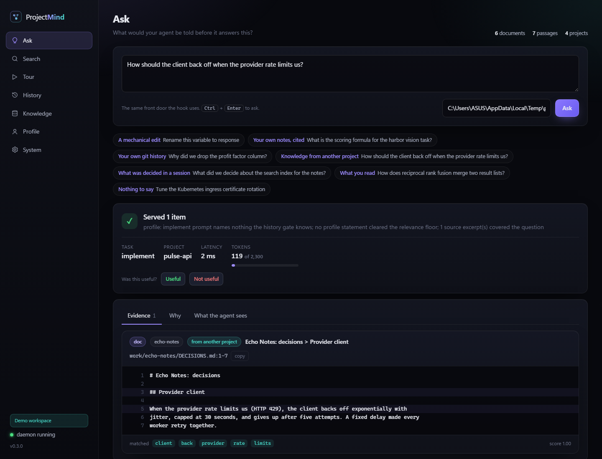
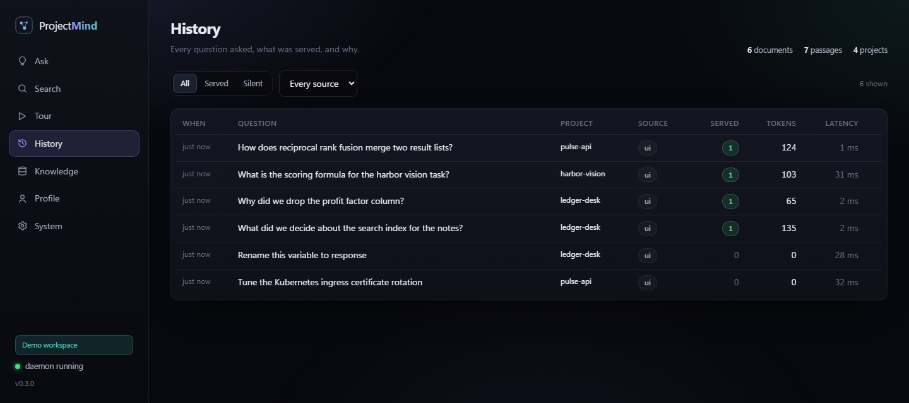
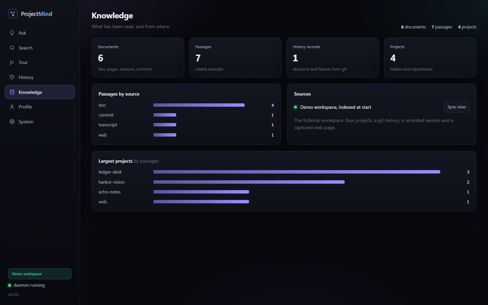

# ProjectMind

**A local memory for your coding agent. It answers from your own work — notes, commits,
competition logs, notebooks, documents, past agent sessions and the pages you read — with
verbatim excerpts and exact citations, and stays silent when it has nothing.**

[](https://github.com/ParthBiyani/ProjectMind/actions/workflows/ci.yml)
[](https://github.com/ParthBiyani/ProjectMind/releases)


[](LICENSE)



## Why

- **Agents forget across projects.** Per-repository context can't see the bug you fixed
  elsewhere, the note that explains a metric, or the commit that dropped a column.
- **Guessing is worse than forgetting.** An unrelated passage in the context silently
  makes the agent worse. ProjectMind serves a passage only when it covers the question.
- **Verbatim and cited.** Every item is copied from a source with its place
  (`notes.md:12-19`, a commit URL, `paper.pdf (page 3)`, `session.jsonl (turn 19)`).
- **Private by construction.** Everything stays on your machine. No API key needed.

## Results

Measured on a real knowledge base (11,257 documents, 30,495 passages) with 42 questions,
including 12 deliberately reworded and 10 about topics that appear nowhere (2026-11-10):

| | Lexical | + semantic search |
|---|---|---|
| Right source cited (answerable questions) | **0.844** | **0.875** |
| Silent on absent topics | **1.000** | **1.000** |
| Explicit search finds the right source (top 8) | 26 / 32 | **30 / 32** |
| Hook latency (through the daemon) | ~220 ms | ~220 ms |

The hook figure is a median of ten runs (196 to 242 ms) and includes Python start-up. The
sync and the embedding run in their own low-priority processes, so a prompt during a sync took
217 to 419 ms. The questions name private projects, so only the scorer and an example format
ship.

A second set guards against grading the system on questions written after seeing its answers:
36 passages were drawn at random (`projectmind eval sample`, seeded), a question was written
from each passage before anything was run, and 30 questions about topics the corpus does not
hold were added. On it: right source cited **0.857** (24 of 28), silent on absent topics
**1.000** (30 of 30). Building it found a word-matching bug that the hand-labelled set had
never exercised, so its negatives are no longer a clean out-of-sample test of that fix; the
semantic bar was then chosen using all 40 absent-topic questions.

Synthetic, reproducible 40-query set (pinned clock): gate precision **1.000**, precision@5
**0.773**, cross-project hit rate **0.325**, false injection **0.095** against a 0.10 target
(all four targets pass; the history-record coverage floor was fitted on this set). The example
format for the real-data set is `eval/real.example.yaml`.

## Features

- **Knowledge base** over git history, notes and `CLAUDE.md` logs, script docstrings,
  notebooks, training-log result lines, small result files, PDF / Word / PowerPoint,
  Claude Code sessions, and browser history and pages (minus a never-capture list).
- **Grounded retrieval**: rarity-weighted coverage with an absolute floor, anchor terms,
  named-project preference, near-duplicate suppression, a hard 2,300-token budget.
- **Optional semantic search** (`BAAI/bge-small-en-v1.5`, on CPU): a strict, calibrated bar
  for automatic injection (cosine 0.80, near the best match, sharing a distinctive word)
  and a generous explicit search where every result says whether it matched by words or
  by meaning.
- **Claude Code integration**: a pre-prompt hook (thin client, ~150 ms) and an MCP server
  (`get_context`, `search_sources`, `search_memory`, `memory_feedback`, `memory_stats`).
- **Always on**: a local daemon syncs every 30 minutes at low priority, starts at logon, and
  is restarted by the next prompt if it ever stops.
- **Web UI** with a **demo mode** that never shows personal data.
- **Full interaction history**: every prompt, what was served, and why each candidate was
  kept or cut; replay, label and export to evaluation.
- **Privacy guards**: whitelist walker, data-dump and identity-document guards, credential
  and identifier redaction, read-only sources, re-auditable index.
- **SQLite by default, Postgres + pgvector** behind the same storage protocol.

## Install it with Claude Code

In Claude Code:

```
/plugin marketplace add ParthBiyani/ProjectMind
/plugin install projectmind@projectmind
```

(or in one step: `/plugin install projectmind --marketplace ParthBiyani/ProjectMind`), then say
**"install ProjectMind"**. The skill checks your machine, lists candidate folders and asks which
to read (it never adds a home folder or anything holding identity or financial documents),
installs the package, builds the index, wires the hook and MCP server with backups, and checks
the result with `projectmind doctor`. It asks before every step that reads your files or changes
your Claude Code configuration. It was developed and tested on Windows 11; the tests also run
on Linux in CI, but starting at logon and reading browser history are Windows-only.

## Quickstart (Windows, Python 3.11+)

```powershell
git clone https://github.com/ParthBiyani/ProjectMind.git
cd ProjectMind
py -m venv .venv
.venv\Scripts\python -m pip install -e ".[mcp,docs,semantic]"
.venv\Scripts\Activate.ps1

projectmind ui --demo                       # see it first: a fictional workspace in the browser
projectmind init --no-seed                  # create the store (--seed loads the author's example profile)
projectmind sources add "D:/Projects"       # choose what to read (look inside first)
projectmind sources add "~/.claude/projects" --kind transcripts --depth 0
projectmind sync                            # read it (minutes the first time)
projectmind semantic enable                 # optional: match by meaning
projectmind semantic index                  # one-off, ~25 min for ~28k passages on a laptop CPU
projectmind install claude-code             # hook + MCP server, with backups; restart Claude Code
projectmind schedule install                # start the daemon at logon, restart it if it stops
projectmind ui                              # the dashboard on your own memory
projectmind doctor                          # verifies everything, including a live hook run
```

From the terminal:

```powershell
projectmind context "Why did we drop the profit factor column?" --project D:\Projects\MyApp
projectmind sources search "how did I handle rate limits"
projectmind history list
```

## How it works

```
 folders / git / sessions / browser ──► walker ─► chunker ─► secret scan ─► index (+ vectors)
                                                                              │
 Claude Code hook ──localhost──► daemon ──► get_context                       │
                                              1 skip mechanical edits         │
                                              2 profile slice                 │
                                              3 history records (gated)  ◄────┤
                                              4 cited passages (coverage) ◄───┤
                                              5 meaning matches (strict) ◄────┘
                                              6 budget ─► excerpts + citations
```

- **Retrieve, then decide.** Mechanical edits ("rename this variable") and messages the
  agent's harness sends on its own are skipped. Everything else is searched, and a passage
  is served only if it covers enough of the question's *distinctive* terms, weighted by
  rarity, including one of its most specific words. Otherwise nothing is served.
- **Grounded output.** Excerpts are copied lines with exact spans; nothing is paraphrased.
- **One daemon.** It keeps the database and vectors warm, answers the hook over localhost
  with a bearer token, runs the scheduled sync, takes browser captures and serves the UI.
  Without it the hook does the work in process (lexical only).

## Web UI

`projectmind ui` opens the dashboard served by the daemon at `http://127.0.0.1:<port>/ui/`:
plain HTML/CSS/JS, dark theme, no external requests.

| View | |
|---|---|
| Ask | The answer with cited excerpts, tokens, latency, the "why" trace and feedback |
| Search | By words and by meaning, each result labelled |
| History · Knowledge · Profile | Every interaction; what is indexed and Sync now; approve or reject statements |
| Evaluation · System | Real-data report (and the scripted tour in demo mode); daemon and settings |

`projectmind ui --demo` serves a fictional, fully indexed workspace on a free port, for
demos. Links can open on a result: `#/ask?s=3`, `#/history?id=latest`, `#/tour?run=1`.
The token reaches the page in the URL fragment (never sent over the network); every API
call needs it; the page has a strict Content-Security-Policy.

| History | Knowledge |
|---|---|
|  |  |

## Browser extension (Edge and Chrome)

Captures the readable text of the pages you read, **except sites on a never-capture list**
that starts with banking, brokers (Kite/Zerodha, Fyers and others), payments, mail, chat,
social media, sign-in pages, password managers, government identity sites, health,
personal documents and cloud consoles. **AI chat sites** (ChatGPT, Claude, Gemini) are read
only on conversation pages, never their sign-in, settings or billing pages.

1. `projectmind browser enable` (the daemon must be running).
2. Open `edge://extensions` (or `chrome://extensions`), turn on **Developer mode**, choose
   **Load unpacked** and select the `extension` folder.
3. Run `projectmind daemon token`, open the extension's **Options**, paste it, press
   **Test connection**. This is one-time: the token and port survive restarts.

Edit the list in **Options**, with **Never capture this site** in the toolbar popup, or
`projectmind browser deny kite.com` / `allow linkedin.com`; adding a site also forgets what
was already read from it. Pages on this computer or the local network, pages asking for a
password or card number, and private windows are never read, and nothing is read until the
list has arrived from the daemon. A page is sent after 20 s in view; URLs lose their query
and fragment; the daemon re-checks every rule and drops credential-like text. When the
daemon is down, captures wait in a queue of 200.

## Privacy

Local only: no network call on the retrieval path, and the daemon listens on loopback with
a bearer token and a Host check. Credentials and personal identifiers (Aadhaar, PAN, SSN,
card numbers, passwords next to a login, one-time codes) are replaced by `[REDACTED:kind]`
before anything is stored, shown or handed to your agent, and text that still looks like a secret
afterwards is dropped whole; identity documents are never opened; sources are
only ever read; browser reading is opt-in and has a never-capture list;
`projectmind sources audit --fix` re-applies the rules to what is already stored.

## Keeping things out

Besides the built-in guards, you choose what is never read:

- **Per folder:** `projectmind sources add D:/Projects --ignore "MyApp/NOTES_PRIVATE.*"`
  (repeatable; saved in `sources.yaml`; re-adding a folder keeps its list).
- **Per project:** a `.projectmindignore` file in any folder, one glob per line. `old/`
  matches folders, `drafts.md` a name anywhere below, `Sub/dir/*.md` a path from that file's
  folder. A file ignored after it was indexed leaves the index on the next sync.
- **Sites:** the never-capture list (extension options, or `projectmind browser deny / allow`).
  Defaults added in later releases reach an existing list once; a site you took off stays
  off. Sign-in pages (`login.*`, `accounts.*`, `auth.*`), email click-tracking links and any
  page whose text looks like a credential are never indexed.

`projectmind sources audit` reports what the current rules would refuse and where it is;
`--fix` removes it.

## Configuration

Read from the environment and `~/.projectmind/.env` (never a project's `.env`).

| Variable | Default | |
|---|---|---|
| `PROJECTMIND_HOME` | `~/.projectmind` | database, sources, logs, token, model |
| `PROJECTMIND_DB_URL` | unset | a `postgresql://` URL switches to Postgres + pgvector |
| `PROJECTMIND_AUTHORS` | git `user.email` | whose commits are yours |
| `PROJECTMIND_HISTORY` | `full` | `full`, `minimal` or `off` |
| `PROJECTMIND_SEMANTIC` | `false` | meaning search (`projectmind semantic enable`) |
| `PROJECTMIND_SEMANTIC_THRESHOLD` | `0.80` | least cosine for an automatic meaning match |
| `PROJECTMIND_EVIDENCE_COVERAGE_FLOOR` | `0.6` | how much of a question a passage must cover |
| `PROJECTMIND_DAEMON_PORT` | `47615` | fixed so the extension can find it |

All settings with rationale: [`config.py`](src/projectmind/config.py).

## Commands

| | |
|---|---|
| `ui [--demo]`, `demo` | Dashboard; guided tour on a fictional workspace |
| `sources add / list / scan / search / audit`, `sync` | What is read; one incremental pass |
| `install claude-code`, `serve`, `daemon status / stop / token`, `schedule install / remove` | Integration and the always-on daemon |
| `context`, `history list / show / replay / label / export` | What the agent would receive; everything asked |
| `profile review / add / edit`, `semantic status / enable / index`, `browser enable / deny / allow / scan` | Profile, meaning search, browser |
| `eval run / real / sample`, `doctor` | Measure it; verify the install |

## Project layout

```
src/projectmind/
  service.py      the front door (get_context, search, history)
  retrieval/      cited-passage and history-record retrieval
  semantic.py     optional meaning search
  gate/           prompt analysis, gating, token budget
  sources/        walker, chunker, readers, transcripts, browser, privacy audit
  ingestion/      git and GitHub extractors
  storage/        Store protocol, SQLite and Postgres backends, migrations
  daemon.py       local server: hook answers, scheduler, capture, web UI
  web/            dashboard and its JSON API
  hook_entry.py   standard-library hook client
  mcp/  cli/  evaluation/  profile/  reflection/
extension/        Edge / Chrome extension
plugins/          the Claude Code plugin: the `install` skill (marketplace: .claude-plugin/)
eval/             synthetic evaluation set, baselines, real-data example
```

## Development

```powershell
.venv\Scripts\python -m pip install -e ".[dev]"
pytest                      # the Postgres half skips without a server
ruff check . ; ruff format --check .
mypy                        # strict
node --test extension/test/lib.test.js
```

CI runs lint, strict types, tests on Python 3.11 to 3.14, a Windows job on 3.12 and 3.14 and the storage
parity suite against a pgvector container. Release history: [CHANGELOG.md](CHANGELOG.md).

## Known limitations

- Automatic injection is precision-first: a question worded very differently from your notes
  may get nothing (semantic search narrows, not closes, this).
- The semantic bar (0.80) is calibrated on 40 absent-topic questions; one leaks at 0.77, so the
  margin is about 0.03, and the questions come from one person's corpus.
- Questions worded very differently from the notes still often get nothing, by design.
- Single user, single machine. Model-written notes are not implemented.

## License

MIT — see [LICENSE](LICENSE).
